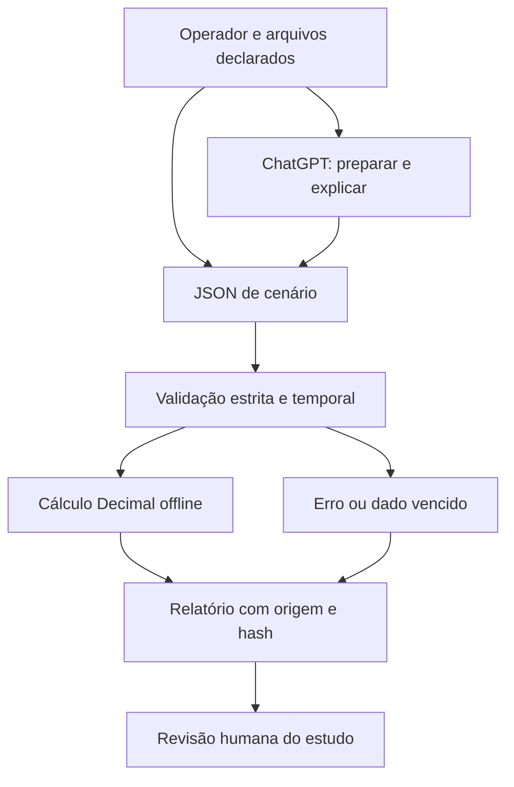

# Arquitetura

## Decisão

Uma biblioteca de domínio e uma CLI locais. O ChatGPT pode ler o contrato, preparar dados declarados e explicar resultados. Python realiza os cálculos. Um único cenário por processo mantém o escopo verificável e evita servidor, autenticação e custos sem necessidade.

Não existe caminho do relatório para negociação. A fronteira de confiança fica entre JSON declarado e validação; o motor não interpreta instruções em textos. Fonte e timestamp são declarações não autenticadas.

## Contratos e componentes

`src/radar_trade_study/engine.py`: validação e cálculo sem I/O de rede. `cli.py`: leitura limitada de um arquivo, rejeição de JSON ambíguo e serialização. `docs/CONTRACT.md`: contrato versionado. `INSTRUCOES.md`: comportamento proposto ao assistente, sem controle de acesso. `examples/`: dados públicos fictícios; `tests/`: casos de cálculo, fronteira e entradas hostis.

Não se presume que instruções sejam executadas em toda conversa. Quando faltarem runner ou arquivos, a resposta deve informar a lacuna e não produzir evidência falsa de execução.

## Stack decision matrix

| Tecnologia | Decisão | Motivo e custo |
| --- | --- | --- |
| Python / Decimal / unittest | ADOPT | Cálculo exato e teste offline na stack familiar; sem dependências runtime |
| ChatGPT por arquivos | ADOPT | Superfície de interação já disponível; execução depende das ferramentas da conversa |
| TypeScript / Astro / React | WATCH | Sem frontend próprio necessário nesta versão |
| FastAPI / MCP remoto | WATCH | Apenas após necessidade de consumidores remotos e autenticação definida |
| PostgreSQL / Supabase | WATCH | Sem persistência ou multiusuário no MVP |
| Docker / VPS / Traefik | WATCH | Nenhum serviço persistente a hospedar |
| n8n / filas / Redis | WATCH | Nenhum evento ou job persistente necessário |
| LLM API / agentes múltiplos / RAG | REJECT nesta fatia | Não melhoram as regras aritméticas; adicionariam custo e incerteza |

## ADR 0001 — implementação própria por arquivos

Contexto: há módulos de replay, backtest e pesquisa financeira no ecossistema; o upstream mistura pesquisa com preparo de ordens em ferramentas para Claude. Decisão: entregar apenas cenários lineares condicionais em código novo e contratos locais. Alternativas: fork completo exigiria manter coleta e fluxos transacionais; serviço MCP exigiria autenticação, hospedagem e homologação; planilha resolveria a aritmética, mas reduziria a validação programática de JSON. Consequências: pequena superfície offline e sem mensalidade adicional do software; não há dados de mercado ou conexão automática no ChatGPT. Operar ChatGPT e infraestrutura preexistente continua sujeito aos planos do usuário.
