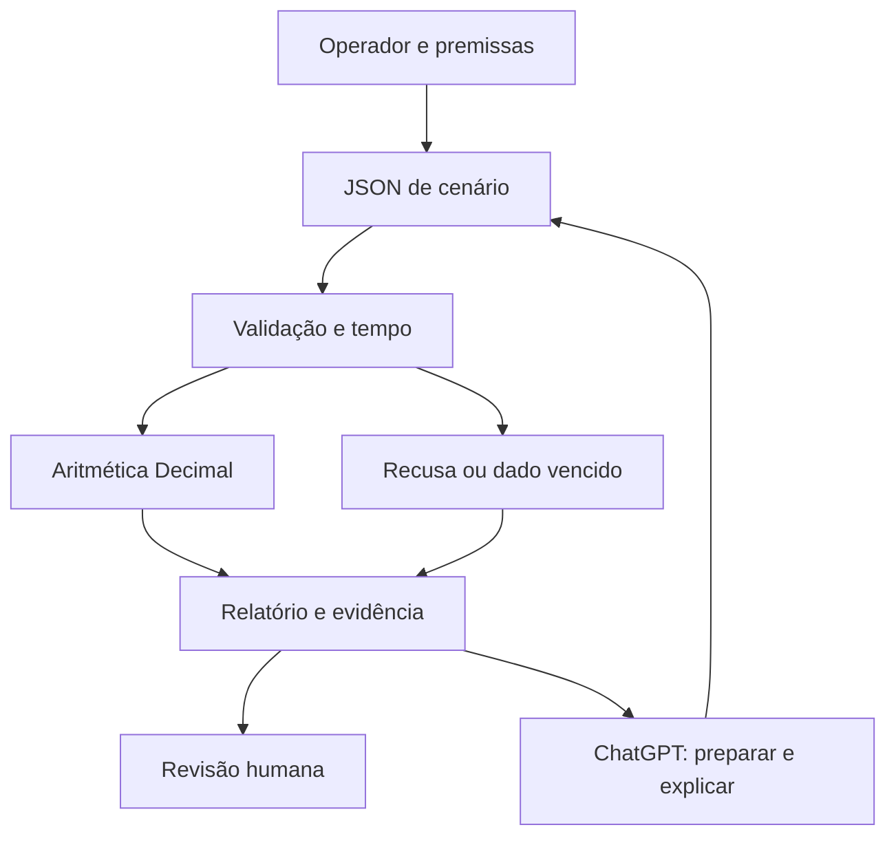

# Auditoria técnica — day-trader-skill → Radar Trade Study ChatGPT

Data de consulta: **22/10/2026**, referência de calendário São Paulo.
Autor da implementação: Carlos Felipe / `ofelipepeixoto`.
Fonte upstream: [Jakeschincariol/day-trader-skill](https://github.com/Jakeschincariol/day-trader-skill/tree/3d0f4ef6986f4984b7c6bd46f7ff4f87744c3abd).
Revisão examinada: `3d0f4ef6986f4984b7c6bd46f7ff4f87744c3abd`, versão declarada 2.0.0.
Este relatório e o código autoral foram revisados em propostas independentes e integrados em `main` pelas [PR #1](https://github.com/ofelipepeixoto/radar-trade-study-chatgpt/pull/1) e [PR #2](https://github.com/ofelipepeixoto/radar-trade-study-chatgpt/pull/2), em 22/10/2026. As observações técnicas abaixo permanecem vinculadas às revisões examinadas; a integração não equivale a homologação financeira ou teste de usuário em uma nova conversa ChatGPT.

## 1. Executive Summary

**Decisão principal: E — REIMPLEMENT. Secundária: B — STUDY.**
O upstream oferece onze ferramentas Python e instruções para Claude, com testes offline e licença MIT.
Seu valor está na decomposição do trabalho e na aritmética verificável; portar o pacote inteiro ampliaria sobreposição e superfície operacional.
Os 315 testes existentes passaram no ambiente restrito da auditoria, mas três casos adicionais reproduziram falhas de números não finitos, barras incompletas e temporalidade.
Recomenda-se o novo `radar-trade-study-chatgpt`: cenários lineares declarados, custos, sizing conservador e explicação no ChatGPT, sem coleta ou execução financeira.

## 2. GitHub Ecosystem Context

O inventário público consultado identificou **52 repositórios públicos**; a inspeção aprofundada foi seletiva, concentrada nas fronteiras pertinentes abaixo.
Isso não equivale a auditar integralmente todos os repositórios ou suas implantações.

| Projeto público | Evidência examinada | Influência na decisão |
| --- | --- | --- |
| [Capital Web3](https://github.com/ofelipepeixoto/capital-web3-advisor) | `risk.py`, portal e contratos em PRs | Preservar patrimônio/DeFi e revisão de entregas |
| [Equity Replay](https://github.com/ofelipepeixoto/radar-equity-replay-lab) | PR #4, motor e caderno offline | Não duplicar replay T→T+1 e benchmark |
| [Backtest ChatGPT](https://github.com/ofelipepeixoto/radar-backtest-chatgpt) | PR #5, comparação/catálogo/MCP | Não criar outro leitor de resultados Freqtrade |
| [TradingAgents](https://github.com/ofelipepeixoto/TradingAgents) | `main`, grafo, provedores e testes | Não adicionar outro grafo de pesquisa por personas |
| [Evidence Kit](https://github.com/ofelipepeixoto/radar-evidence-kit) | `main`, contratos/diário/proveniência | Reutilização futura somente se houver necessidade de recibos |
| [Aprovação humana](https://github.com/ofelipepeixoto/agente-aprovacao-humana) | `main`, proposta e ferramenta fictícia | Padrão didático; não autentica aprovação financeira |

Revisões públicas de implementação: [Capital PR #17 / 8368ebf](https://github.com/ofelipepeixoto/capital-web3-advisor/tree/8368ebf9254875f6166a3b0d46354ae495cbfe54), [Equity PR #4 / 42898ce](https://github.com/ofelipepeixoto/radar-equity-replay-lab/tree/42898cefa93fde27721fa568956d35dfcf9ba661) e [Backtest PR #5 / 618fe27](https://github.com/ofelipepeixoto/radar-backtest-chatgpt/tree/618fe277703d4cc2ad9bb4fb6b3d77171194d0d6).
Os snapshots de `main` examinados foram [TradingAgents / 8b22d43](https://github.com/ofelipepeixoto/TradingAgents/tree/8b22d43d01d9ddda5d686d093d5385884622f3de), [Evidence / 22d3cae](https://github.com/ofelipepeixoto/radar-evidence-kit/tree/22d3cae88f1a43f55f75d880bbe6b46d5582d0ba) e [Aprovação / a39ccd7](https://github.com/ofelipepeixoto/agente-aprovacao-humana/tree/a39ccd71ede3a143e10f72b25e3c3860b1a9a1f4).

## 3. Repository Overview

[CODE VERIFIED] A árvore upstream contém 85 arquivos, onze módulos Python de domínio, onze `SKILL.md`, doze arquivos de teste e um carregador de testes.
Os módulos são scanner, notícias, entrada, saída, replay, risco, orçamento, ticket de corretora, alertas, fundamentos e divulgações públicas de congressistas.
O núcleo usa biblioteca padrão; a extração de PDF pode chamar `pdftotext`, utilitário externo opcional.
Há arquivos JSON compartilhados de configuração, plano, ordens e estado local.
Não foram encontrados servidor API, frontend, banco, SDK LLM, Docker, manifesto de dependências Python ou workflow de CI na revisão fixada.
Os endpoints de leitura incluem Yahoo, Nasdaq Trader, SEC EDGAR e House Clerk; disponibilidade e direitos de uso permanecem externos ao pacote.

## 4. Evidence Level

| Rótulo | Significado aplicado | Exemplo |
| --- | --- | --- |
| CODE VERIFIED | Encontrado em fonte/configuração na revisão fixada | CLIs, MIT, arquivo de ticket e fórmulas |
| TEST VERIFIED | Comportamento executado nesta auditoria | 315 testes e três reproduções adicionais |
| DOC CLAIM | Declaração documental sem homologação correspondente | Experiência com corretora e cadência dos monitores |
| INFERENCE | Conclusão derivada de código e requisitos | Arquivos compartilhados dificultariam multiusuário |
| NOT VERIFIED | Evidência insuficiente ou acesso ausente | Página comercial e integração real no ChatGPT |

Um teste existente aprovado demonstra apenas os casos exercitados. Nenhuma operação de corretora, coleta live ou chamada paga foi usada nesta validação.
Para repetir a suíte padrão, a partir da revisão upstream fixada: `python3 -m unittest discover -s tests -v`.
Nesta auditoria, a descoberta foi executada em runner com ambiente minimizado e audit hook que recusava sockets, subprocessos e spawn, sem instalar dependências.
Esse bloqueio restringe os caminhos exercitados; não é alegação de sandbox geral ou garantia sobre código arbitrário.
As três reproduções adicionais chamaram funções/CLI em processo e exigiram as saídas descritas na seção 8; não foram incorporadas ao upstream.
O [método de validação](UPSTREAM-VALIDATION.md) e o [ensaio autoral de reprodução](reproduce_upstream.py) permitem repetir esses casos após obter/revisar separadamente o upstream fixado.
Para o código novo, [VALIDATION.md](https://github.com/ofelipepeixoto/radar-trade-study-chatgpt/blob/bae4838b5cecaac2ae5e7cbacecd21a8a9ec6512/docs/VALIDATION.md) registra 24 testes aprovados, 981 cenários comparados com referência racional `Fraction` e três timezones equivalentes em Python 3.12/Linux.
Essas validações são distintas da suíte upstream; não comprovam Windows, ambiente de todo usuário, integração na conta ChatGPT ou execução de CI hospedada.

## 5. License & IP

[CODE VERIFIED] A [licença upstream](https://github.com/Jakeschincariol/day-trader-skill/blob/3d0f4ef6986f4984b7c6bd46f7ff4f87744c3abd/LICENSE) é MIT, copyright 2026 Jake Schincariol.
Ela permite reutilização, modificação e distribuição, inclusive comercial, com preservação do aviso e da licença nas cópias ou porções substanciais.
A licença do código não estabelece direitos universais sobre dados, PDFs, marcas, imagens ou serviços consultados.
A implementação usa código novo e registra a referência em [NOTICE.md](https://github.com/ofelipepeixoto/radar-trade-study-chatgpt/blob/bae4838b5cecaac2ae5e7cbacecd21a8a9ec6512/NOTICE.md); não importa scripts, fixtures ou instruções upstream.
A página `https://gabriel-conteudos.vercel.app/c/trader?src=dm` não ficou acessível para verificação; seu conteúdo, preços e método são NOT VERIFIED e não foram copiados.
A MIT local cobre o material autoral, sem transferir autoria ou licença de terceiros.

## 6. Architecture Review

O fluxo upstream é uma coleção de CLIs coordenadas por instruções ao assistente: coleta → hipótese de entrada/saída → replay → orçamento → risco → ticket.
Alertas, notícias e outros coletores usam arquivos próprios, sem um orquestrador transacional único.
O módulo de corretora prepara argumentos para uma ferramenta externa; não envia ordens diretamente por HTTP no Python inspecionado.
Isso separa parcialmente cálculo e ferramenta transacional, mas não cria autorização de servidor entre todas as etapas.
O novo desenho preserva somente preparação de entrada → validação → aritmética → relatório → revisão humana.
Interface, dados atuais, custódia, contas, publicação e execução ficam fora dessa fatia.

## 7. Code Quality

Pontos positivos: funções de domínio separadas, biblioteca padrão, fixtures e testes de cronologia, limites e reconhecimento de stop como plano.
Problemas concretos: uso inconsistente de `float`, validações de completude insuficientes e regras de calendário/tempo distribuídas entre módulos.
Os caminhos de CLI e JSON facilitam experimentar, mas contratos entre etapas dependem de convenções e arquivos mutáveis.
O problema de NaN demonstra que validação por comparação positiva não basta para garantir número financeiro válido.
Para o código novo, um contrato único, Decimal e recusa explícita de campos desconhecidos reduzem ambiguidades.
Não se recomenda migrar todo o upstream para outra linguagem por padronização estética.

## 8. Security Audit

As prioridades abaixo descrevem condições observadas; não são CVEs, CVSS ou alegações de exploração externa.

| Prioridade | Local upstream | Condição e consequência | Evidência |
| --- | --- | --- | --- |
| P1 | `trader-risk/check.py:278–282,439–445` | `notional="NaN"` produz PASS e grandezas NaN | Reprodução offline |
| P1 | `trader-entry/entry.py:482–496` | Uma de três barras de abertura pode ser marcada completa e disparar ORB | Reprodução offline |
| P1 | `trader-exit/exit.py:442–466,538–540,584–588` | Hora manual sem índice de barra permite ATR usar barras posteriores | Reprodução offline |
| P1 para estudo histórico | `trader-scanner/scan.py:498–513,552–557,571–572` | Closes são cortados pela data, mas metadados atuais podem contaminar a seleção | Inspeção; efeito econômico não medido |
| P1 para conexão remota | `trader-broker/ticket.py:145–150,315–324` | Fingerprint não vincula conta/corretora/modo/carteira e não tem TTL curto | Inspeção; exploração não executada |
| P2 para serviço | Leitores HTTP e estado JSON | Limites de bytes/descompressão e concorrência insuficientes para exposição pública | Inspeção; capacidade não medida |

Há controles positivos: aprovação por ordem e fingerprint, padrão paper, domínios de fonte fixados e subprocesso PDF com argumentos e timeout, sem shell.
Eles não tornam o pacote adequado a servir dados de múltiplas pessoas ou a controlar capital real.
Não foi identificada necessidade de publicar segredos ou material de clientes para desenvolver esta adaptação.

## 9. Performance

[TEST VERIFIED] A suíte upstream executou 315 testes em aproximadamente 11,6 segundos naquele runner.
Esse tempo mede testes com fixtures, não velocidade de varredura live, qualidade do sinal ou latência de corretora.
O scanner e os replays processam conjuntos de barras; rede e repetição de coleta podem dominar o tempo operacional.
O bootstrap de barras em `trader-timemachine/timemachine.py:335–367` não preserva todas as dependências temporais/regimes: 10 mil replays não são 10 mil sessões independentes observadas.
Não foram encontrados calibração fora da amostra ou intervalos que sustentem tratar a frequência simulada como probabilidade real de sucesso.
O mesmo módulo, em `:369–391,470–479`, omite custos/spread/slippage e representa stop como -1R mesmo em gaps; a própria documentação reconhece a simplificação.
Não foram executados benchmark, perfil de CPU/memória ou teste de carga.
O novo laboratório calcula um cenário por processo; uma operação aritmética limitada dispensa cache distribuído, GPU e filas.
Qualquer meta de latência futura deve ser medida com ambiente e entrada documentados.

## 10. Scalability

| Cenário | Avaliação baseada na arquitetura |
| --- | --- |
| Local, um operador | Fronteira coerente para laboratório, com entradas controladas |
| 10 operadores | Cópias isoladas podem funcionar; não há homologação de compartilhamento |
| 100 operadores | Exigiria serviço, autorização, limites e observabilidade próprios |
| 1.000 ou 10.000 | Sem benchmark ou arquitetura que sustente promessa de capacidade |
| Multi-tenant | Ausentes identidade, isolamento, quotas e retenção por organização |

Estado em arquivos não deve virar banco compartilhado implicitamente. O novo repo permanece local e sem alegação de escalabilidade de serviço.

## 11. AI Engineering

O upstream fornece instruções de contexto e chamadas de CLIs, não um SDK de modelo ou backend próprio de inferência.
Há separação útil entre linguagem e cálculo; faltam avaliações de precisão das explicações, aderência a fontes e resistência a instruções maliciosas recuperadas.
No projeto novo, ChatGPT prepara e explica; Python valida números, datas, limites e fórmulas.
Textos de origem são dados não confiáveis e não concedem permissões.
Se não houver ferramenta Python ou arquivos acessíveis, o assistente deve declarar que não executou o motor.
Não há escolha de modelo, roteamento, embeddings, custo de tokens ou API paga configurados nesta implementação.

## 12. Agentic AI

As onze especialidades upstream são papéis instrucionais e ferramentas, não onze agentes de runtime comprovados.
Um fluxo determinístico resolve a fatia escolhida sem planner, memória autônoma ou supervisor multiagente.
O usuário escolhe orçamento de risco, teto nocional, preços e custos; o motor não decide esses valores.
O retorno pode ser `needs_input`, `error`, `degraded`, `no_valid_scenario` ou `ok`, sempre com execução desabilitada.
Autonomia futura só faria sentido com uma tarefa decisória concreta, avaliação e autoridade delimitada.
Nenhum benefício justifica adicionar um grafo de agentes apenas para representar funções humanas.

## 13. RAG

Não há pipeline RAG implementado no upstream: não foram encontrados embeddings, índice vetorial, recuperação ou reranking.
Consultar uma notícia ou filing não equivale a construir RAG.
O MVP novo também não precisa de RAG para calcular um cenário conhecido.
Se uma futura base de métodos for necessária, deverá separar documento, revisão, evidência, recuperação e avaliação de suporte.
O Evidence Kit pode fornecer contratos de evidência; ele não demonstra verdade financeira ou qualidade de recuperação por si só.
PostgreSQL/PGVector ou banco especializado ficam sem justificativa nesta versão.

## 14. MCP Opportunities

O upstream menciona ferramenta externa de corretora, mas não contém servidor MCP próprio de domínio.
Um servidor de leitura para validar/calcular cenários seria tecnicamente possível, após demonstrar necessidade de vários consumidores.
Deveria aceitar somente contrato fechado e devolver relatório, sem caminho, URL arbitrária, código ou credencial escolhidos pelo modelo.
Remoto exigiria autenticação, escopos, limites, isolamento e teste real do cliente.
O MVP entrega arquivos e CLI; anexar um repo não instala MCP nem cria conexão nativa.
Essa oportunidade é WATCH, sem endpoint implementado ou homologado.

## 15. n8n Opportunities

n8n poderia futuramente organizar recebimento autorizado de snapshots, geração de rascunho e encaminhamento para revisão.
Fórmulas, validação financeira e autorização devem permanecer em código testável.
Alertas demandariam fonte, validade, scheduler, responsável e canal explicitamente definidos.
Nenhum workflow foi importado ou ativado; não há monitoramento contínuo nesta entrega.
Não se propõe notificação automática a terceiros nem mensalidade adicional.
Adotar n8n agora não resolveria uma necessidade do CLI de um cenário por execução.

## 16. Infrastructure

O upstream é executado localmente por Python; a revisão não contém Docker, banco ou API de produção.
O novo repo requer Python 3.11+ e biblioteca padrão, sem serviço persistente.
VPS, Docker/Compose, Traefik, Cloudflare e Supabase continuam opções para um produto futuro, não pré-requisitos.
Não foram abertas portas, provisionados recursos ou alteradas aplicações existentes para esta fatia.
O isolamento aqui resulta do escopo local e ausência de conectores, não de uma alegada sandbox implementada pelo projeto.
Sem backend remoto, não há autenticação ou proteção multiusuário a declarar como pronta.

## 17. Observability

O upstream registra estados e resultados em JSON; isso ajuda inspeção, mas não oferece tracing distribuído ou auditoria autenticada.
No novo código, estado, origem declarada, horário de observação/avaliação, versão e hash ajudam reproduzir o cálculo.
Hash identifica conteúdo; não autentica autor, origem, data ou aprovação.
Erros do parser não devem ecoar o documento inteiro ou valores possivelmente sensíveis.
Não há telemetria remota, Langfuse, Sentry, Prometheus ou Grafana instalados.
Para esta escala, preservar entrada e resultado localmente por escolha do operador é suficiente; política de retenção não é automatizada.

## 18. Stack Decision Matrix

| Tecnologia | Situação | Decisão | Justificativa e consequência |
| --- | --- | --- | --- |
| Python / biblioteca padrão | Afinidade existente; upstream Python | ADOPT | Menor dependência operacional |
| Decimal / unittest / JSON | Núcleo novo | ADOPT | Aritmética e recusas verificáveis |
| ChatGPT por arquivos | Interface de trabalho escolhida | ADOPT | Execução depende das ferramentas da conversa |
| Claude SKILLs | Específicas do upstream | Não portar | Escrever instruções PT-BR próprias |
| TypeScript / Astro / React | Disponíveis no ecossistema | WATCH | Nenhum frontend próprio necessário |
| FastAPI / MCP remoto | Sem consumidor remoto neste MVP | WATCH | Adicionariam hospedagem e autorização |
| Supabase / PostgreSQL | Sem persistência compartilhada | WATCH | Não criar banco sem necessidade |
| Docker / VPS / Traefik | Sem processo permanente | WATCH | Nenhum deploy necessário |
| Redis / Kafka / filas | Sem jobs assíncronos | REJECT nesta fatia | Complexidade sem problema demonstrado |
| RAG / API LLM / multiagente | Sem benefício para regras exatas | REJECT nesta fatia | Evitar custo e variabilidade desnecessários |

## 19. GitHub Integration Map

| Componente estudado | Destino ou fronteira | Forma recomendada |
| --- | --- | --- |
| Sizing e plano condicional | Novo `radar-trade-study-chatgpt` | NEW REPOSITORY; código original |
| Replay e benchmark | `radar-equity-replay-lab` | Preservar projeto existente; sem novo engine |
| Exports históricos | `radar-backtest-chatgpt` | Preservar leitor; sem importador duplicado |
| Teses por LLM | `TradingAgents` | EXPERIMENT ONLY; integração não realizada |
| Patrimônio/DeFi e entrega revisada | `capital-web3-advisor` | Contrato de rascunho futuro; sem copiar código |
| Proveniência de documentos | `radar-evidence-kit` | SHARED LIBRARY somente se o requisito surgir |
| Aprovação antes de ação | `agente-aprovacao-humana` | Referência didática; sem executor financeiro |

As capacidades citadas em branches/PRs não são presumidas disponíveis no clone de `main`. Nenhum desses consumidores foi alterado.

## 20. Product Opportunities

| Possibilidade | ICP e valor | Estado e custo |
| --- | --- | --- |
| Laboratório educacional | Pessoa que quer entender risco/custos com entradas explícitas | MVP offline; sem API paga |
| Ferramenta interna consultiva | Analista revisando cenários declarados | Hipótese; exige escopo e processo de revisão |
| API/MCP de cálculo | Equipe com vários consumidores do mesmo contrato | Futuro; autenticação e operação ampliariam manutenção |
| SaaS/white-label | Organização com necessidade comprovada de fluxo e histórico | Não validado; não construir antes de demanda |

A diferenciação possível está na transparência do contrato e nas recusas reproduzíveis, não em promessa de performance financeira.
Preço, disposição a pagar, aquisição, retenção e vantagem competitiva não foram medidos; qualquer modelo comercial permanece hipótese.
Sem novo SaaS obrigatório, o custo incremental do software offline tende a ser manutenção e uso do ambiente já contratado, não custo zero universal.

## 21. Architecture 2.0

Arquitetura recomendada e representada pelo candidato autoral:



Não há ligação com corretora ou caminho de negociação. Fonte/horários continuam declarações do operador.
O [contrato](https://github.com/ofelipepeixoto/radar-trade-study-chatgpt/blob/bae4838b5cecaac2ae5e7cbacecd21a8a9ec6512/docs/CONTRACT.md) fixa unidades, custos, multiplicador, lote e teto nocional; a [arquitetura](https://github.com/ofelipepeixoto/radar-trade-study-chatgpt/blob/bae4838b5cecaac2ae5e7cbacecd21a8a9ec6512/ARCHITECTURE.md) registra alternativas.

## 22. Code Improvements

| Problema | Correção concreta proposta | Como verificar |
| --- | --- | --- |
| NaN aceito no risco | Recusar não finitos, bool e coerção; serializar JSON sem NaN | Inserir NaN/Infinity, string e valor JSON; nenhum PASS |
| ORB parcial | Exigir todos os slots esperados e OHLC íntegro antes de avaliar | Remover uma barra intermediária; resultado indisponível |
| ATR com futuro | Derivar cutoff da hora e validar coerência com índice informado | Mesmo horário produz mesma janela com/sem índice consistente |
| Fingerprint limitado | Vincular proposta a conta/modo/versão/validade no executor confiável | Trocar conta ou expirar TTL invalida a autorização |
| Replay simplificado | Separar retorno bruto, custos e política de gap; avaliar fora da amostra | Gap adverso pode exceder 1R; custos alteram resultado |

Uma guarda numérica mínima, escrita aqui como proposta independente, seria:

```python
from math import isfinite

def positive_finite(value):
    if type(value) is int:
        return value > 0
    return type(value) is float and isfinite(value) and value > 0
```

Isso não substitui um contrato financeiro completo. O código novo usa strings decimais limitadas e Decimal, além de campos fechados e saída `execution_enabled=false`.
Ele **não corrige upstream ORB/ATR**: indicadores, séries e executor foram excluídos do escopo em vez de portados.

## 23. Technical Scorecard

Escala de julgamento técnico: 0 ausente/inadequado, 5 laboratório com lacunas materiais, 10 evidência robusta para o escopo. Não é benchmark, certificação ou ranking de investimento.

| Dimensão upstream | Nota | Evidência e limite |
| --- | ---: | --- |
| Architecture | 6 | Onze módulos coesos; estado compartilhado sem contrato transacional único |
| Code Quality | 6 | Funções/testes úteis; validação financeira e temporal inconsistente |
| Security | 4 | Aprovação por ordem e paper; NaN e fronteira de autorização incompleta |
| Reliability | 4 | Três falhas reproduzidas apesar da suíte verde |
| Performance | 5 | Stdlib/fixtures viáveis; sem benchmark live ou perfil de recursos |
| Scalability | 3 | CLI local; concorrência e multiusuário não demonstrados |
| Testing | 7 | 315 testes executados; lacunas negativas/temporalidade ainda relevantes |
| Documentation | 7 | README, SKILLs e exemplos; marketing de probabilidades excede evidência |
| DevOps | 2 | Ausentes CI, lock/manifest Python e deploy na revisão |
| AI Engineering | 5 | Boa separação cálculo/linguagem; sem evals do assistente |
| Agentic Architecture | N/A | Não há runtime de agentes próprio para avaliar |
| Innovation | 5 | Combinação útil de tarefas; vantagem estatística não demonstrada |
| Maintainability | 6 | Módulos simples e testes; regras duplicadas e arquivos acoplados |
| Fit com meu GitHub | 6 | Boa referência; adoção completa duplicaria domínios existentes |
| Fit com Help Mídias | 4 | Aprendizado e contratos reutilizáveis; demanda comercial não validada |
| Product Potential | 5 | Laboratório possível; operação financeira e mercado sem validação |

Não se calcula média para liberar uso: um defeito relevante de segurança/correção prevalece sobre pontuações positivas.

## 24. Adoption Decision

**E — REIMPLEMENT** é a estratégia principal: preservar ideias úteis e escrever uma fatia independente para ChatGPT.
**B — STUDY** é a secundária: usar upstream como material de auditoria, testes e discussão de limitações.
Fork completo não é recomendado como base deste produto, embora a MIT o permita com as obrigações aplicáveis.
F — ADAPT exigiria carregar e manter coletores, indicadores e fronteiras transacionais sem necessidade para o objetivo escolhido.
D — INTEGRATE não deve ocorrer antes de contrato e consumidor reais; G — PRODUCTIZE depende de validação de utilidade e operação.
Essa decisão pode ser revista por evidência nova, sem assumir que todo módulo merece adoção.

## 25. Build vs Adopt vs Buy

| Caminho | Benefício | Custo/risco | Decisão |
| --- | --- | --- | --- |
| BUILD mínimo | Contrato próprio, escopo pequeno, controle de cálculo | Manutenção e revisão sob responsabilidade do projeto | Recomendado |
| ADOPT upstream inteiro | Muitas tarefas disponíveis para Claude | Sobreposição, defeitos e adaptação de plataforma | Somente estudo isolado |
| BUY solução externa | Pode reduzir construção se houver aderência comprovada | Preço/termos/lock-in e eficácia não avaliados | Sem contratação proposta |

Não há preço de SaaS ou economia estimada comprovados. Primeiro comparar utilidade do exemplo, clareza de recusas e custo de manutenção; só depois reabrir compra.

## 26. Repository Strategy

Nome: **radar-trade-study-chatgpt**. Descrição: estudos condicionais de risco para ChatGPT com cálculo determinístico offline.
Visibilidade: pública e experimental; licença MIT para o código original, autoria Carlos Felipe e referência upstream registrada.
Topics sugeridos: `chatgpt`, `python`, `risk-analysis`, `educational`, `offline`, `decimal`, `human-in-the-loop`.
Estrutura útil: `src/radar_trade_study`, `tests`, `examples`, `docs`, instruções, contrato, segurança e arquitetura.
As PR #1 e #2 foram integradas: a primeira acrescentou auditoria e evidências; a segunda acrescentou motor, instruções, código, testes e guias. Esses arquivos estão disponíveis em `main`.
Sem fork, release estável, deploy ou conexão automática implícitos; conferir URLs/estado reais das PRs no GitHub.

## 27. Implementation Roadmap

| Fase | Entrega ou gate | Situação/condição |
| --- | --- | --- |
| 0 — Due Diligence | Licença, mapa, código e reproduções | Executados no escopo deste relatório |
| 1 — Proof of Concept | Contrato linear, CLI e exemplo fictício | Implementação integrada em `main`; execução local validada e homologação com operador pendente |
| 2 — Hardening | Negativos, limites, erros e cálculos independentes | 24 testes e verificador racional executados; limites em VALIDATION.md |
| 3 — Integration | Consumidor com contrato/versionamento definidos | Não realizada; somente se necessária |
| 4 — Observability | Evidência local suficiente; operação se virar serviço | Sem telemetria instalada |
| 5 — Evals | Operador em conversa nova, execução e interpretação | Homologação humana pendente |
| 6 — Production | Escopo, dados e operação aprovados | Fora do MVP offline |
| 7 — Scale | Benchmark e limites conforme demanda | Sem promessa de capacidade |
| 8 — Productization | ICP, disposição a pagar e manutenção validados | Hipótese futura |

## 28. Priority Backlog

| Prioridade | Item | Critério de encerramento |
| --- | --- | --- |
| P0 | Nenhuma emergência destrutiva identificada nesta revisão | Não elevar hipótese a incidente |
| P1 | Não promover risco/ORB/ATR upstream como corretos | Regressões negativas explícitas e correção validada antes de eventual adoção |
| P1 | Manter nova fatia sem executor e números não finitos | Parser/motor recusam entradas e sempre desabilitam execução |
| P1 | Impedir interpretação de snapshot histórico como cotação atual | Origem/horários e significado dos estados visíveis |
| P2 | Homologar uso por arquivos em nova conversa | Segundo operador distingue cálculo real de explicação |
| P2 | Confirmar unidades/custos/lotes com casos independentes | Relatório de validação reproduzível e limitações explícitas |
| P3 | Avaliar histórico de estudo e exportação revisada | Necessidade demonstrada; não criar banco preventivamente |

## 29. Top 10 Actions

1. Fixar a revisão upstream e preservar atribuição MIT.
2. Manter as três reproduções como critérios de não regressão de uma eventual adoção.
3. Entregar contrato pequeno de cenário linear, sem portar onze módulos.
4. Exigir orçamento monetário e teto nocional escolhidos pelo operador.
5. Calcular com Decimal, custos explícitos e lote arredondado para baixo.
6. Recusar NaN, campos desconhecidos, datas futuras relativas e JSON ambíguo.
7. Reter sizing quando o snapshot ultrapassar a validade declarada.
8. Apresentar estados/unidades e origem antes de números derivados no ChatGPT.
9. Revisar auditoria e implementação em PRs independentes com validação própria.
10. Homologar o exemplo por outro operador antes de decidir integrações ou produto.

## 30. Final Technical Recommendation

Eu manteria `day-trader-skill` como referência técnica MIT e construiria **Radar Trade Study ChatGPT** como pacote autoral consultivo offline.
Ele preenche uma lacuna de sizing linear e validação de premissas sem duplicar replay, pesquisa multiagente, portal DeFi ou leitura de backtests.
O projeto contém motor/CLI, exemplo, contrato e instruções integrados em `main`; teste executado, CI e integração são evidências separadas, e a homologação por um operador em nova conversa ChatGPT permanece pendente.
Os comandos e resultados próprios estão em [VALIDATION.md](https://github.com/ofelipepeixoto/radar-trade-study-chatgpt/blob/bae4838b5cecaac2ae5e7cbacecd21a8a9ec6512/docs/VALIDATION.md): 24 testes, compilação, superfície offline, exemplo e 981 comparações racionais; não herdam os 315 testes upstream.
Para usar no ChatGPT, seguir [USAR-NO-CHATGPT.md](https://github.com/ofelipepeixoto/radar-trade-study-chatgpt/blob/bae4838b5cecaac2ae5e7cbacecd21a8a9ec6512/docs/USAR-NO-CHATGPT.md) e a [documentação oficial de Projetos](https://learn.chatgpt.com/docs/projects): disponibilizar fontes e instruções não equivale a instalar ferramentas ou sincronizar uma pasta automaticamente.
Nenhuma mensalidade adicional de software, API paga, VPS, execução financeira ou integração com outros repositórios é necessária para esta primeira entrega.
